# Heavy-Rain Forecasting for Vietnam's 34 Provinces with a Big Data Pipeline

*BDA501 Big Data Analytics — Final Project Report* — Team: Việt · Luân · Thịnh — November 2026

## Executive summary

We built an end-to-end Big Data system that forecasts, for every 0.25° ERA5 grid cell over Vietnam's land (493 cells), whether the rain in the next 24 hours will exceed 50 mm — the heavy-rain threshold of Decision 18/2021/QĐ-TTg — and rolls the cell forecasts up to the 34 provinces created by the 2025 merger. The data is the ERA5 reanalysis from the Copernicus Climate Data Store, 13 variables, hourly, 2015–2025: 47.5 million cell-hours.

- Pipeline: CDS download → raw/bronze (also on HDFS) → silver → gold on Apache Spark; Hadoop MapReduce and Spark SQL analytics; Spark ML training; Kafka + Spark Structured Streaming; MongoDB serving; a live web map.
- Model: Random Forest on 33 features (local weather + atmospheric moisture/instability, "M4"). On the held-out years 2024–2025 it reaches PR-AUC 0.420 (95 % CI 0.34–0.49) versus 0.147 for persistence and 0.012 for random guessing.
- Feature and algorithm choices are evidence-based: atmosphere features add +0.059 PR-AUC (CI 0.029–0.086), terrain and neighbouring cells add nothing; Random Forest beats logistic regression (+0.052, CI above 0) and ties with gradient-boosted trees.
- Streaming was tested against injected dirty data and a mid-run crash: all 125,939 Kafka messages read exactly once, all duplicates and broken records caught, 0 duplicate forecasts, and the stream produced exactly the same forecasts and feature vectors as batch.
- Main limitations, stated openly: recall is 46 % at the F1 threshold (decision support, not a stand-alone warning); ERA5 is published ~5 days late, so the streaming demo is a replay (hindcast); infrastructure runs on one laptop; MapReduce and the three Spark SQL queries were validated on the pilot data only.

| Member | Main technical responsibility |
|---|---|
| Mr. Việt [full name, student ID] | Batch layer: ingestion, 63 → 34 province mapping, bronze → gold, cleaning rules, MapReduce, Spark SQL |
| Mr. Luân [full name, student ID] | ML & evaluation: EDA, NOAA validation, features, Random Forest + ablation, class imbalance, performance experiment |
| Phạm Lê Tấn Thịnh (25MS23273) | Streaming & serving: Kafka producer and junk tests, Structured Streaming, MongoDB data model, web dashboard |

*Table 1. Team contributions (as presented in the deck; team to confirm names and IDs).*

## 1. Problem and Big Data justification

Heavy rain is the most frequent natural hazard in Vietnam: it causes flash floods and landslides in the mountains and flooding along the central coast, and Typhoon Yagi (September 2024) showed how fast it develops. Operational warnings are issued by province, but provinces are large (after the 2025 merger one province covers 3–35 of our cells), so we forecast per cell and keep the cell-level detail when rolling up to provinces.

Task: for each cell and hour t, predict whether total rain in (t, t+24 h] exceeds 50 mm. This is a rare-event binary classification: only 0.9 % of training cell-hours and 1.2 % of test cell-hours are positive.

| V | Our data |
|---|---|
| Volume | 47.5 M cell-hours × 33 features (gold 5.2 GB Parquet); raw 4.7 GB NetCDF; scaling to more years, finer grids or more variables multiplies this linearly |
| Velocity | a new hour of data for 493 cells every hour; streaming lane with micro-batches every 10 s |
| Variety | gridded NetCDF (CDS), province polygons (GeoJSON), station records (NOAA CSV), JSON messages, MongoDB documents |
| Veracity | reanalysis vs gauges, unit/time-zone conversion, missing/late/duplicate records in the stream |

*Table 2. Why this is a Big Data problem.*

## 2. Data

### 2.1 Sources

| Dataset | Use | Size / scope |
|---|---|---|
| ERA5 single levels, hourly (Copernicus CDS) | all features and the label | 13 variables, box 23.5–8.5 °N × 102–110 °E, 2015–2025; 67 requests on 6 team accounts (2 months per request), 68 zip files, 4.7 GB |
| geoBoundaries ADM1 (63 provinces) + official 63 → 34 merger table | assign cells to provinces | 63 polygons |
| NOAA GHCN-Daily | independent check of the ERA5 label | 14 Vietnamese gauges, 2015–2025 |
| Open-Meteo ERA5 API | pilot data and cross-check of our CDS processing | 63 points |
| OpenTopoData SRTM 90 m | terrain features (tested, not kept) | 493 cell centres |

*Table 3. Data sources.*

The 13 ERA5 variables are 7 surface variables (precipitation, 2 m temperature and dew point, sea-level pressure, cloud cover, 10 m wind u and v) and 6 column variables (total column water vapour, eastward/northward vertically integrated moisture flux, moisture divergence, CAPE, K-index). They were chosen to cover the ingredients of heavy rain: available moisture, moisture transport and convergence, lifting, and instability.

### 2.2 From grid to provinces

The download box contains 61 × 33 = 2,013 grid points. Each 0.25° cell is sampled with a 5 × 5 grid of points and every point is tested against the 63 old-province polygons (point-in-polygon). A cell is kept if at least 25 % of its points fall inside Vietnam (493 cells); its old province is the one containing most points (247 cells straddle a border), and the old → new lookup gives one of the 34 merged provinces. Forecasts stay per cell; a province's risk is the maximum probability over its cells and it is alerted if any cell is above the threshold.

The province definition matters: on the test years there are 20,138 positive province-hours with any-area (≥ 1 cell > 50 mm), 13,783 with the 90th percentile and 9,918 with coverage ≥ 25 % of cells — 11 × apart for Lâm Đồng (35 cells), almost equal for 3–4-cell provinces. We keep any-area so local extremes are not missed and show the share of alerted cells next to it.

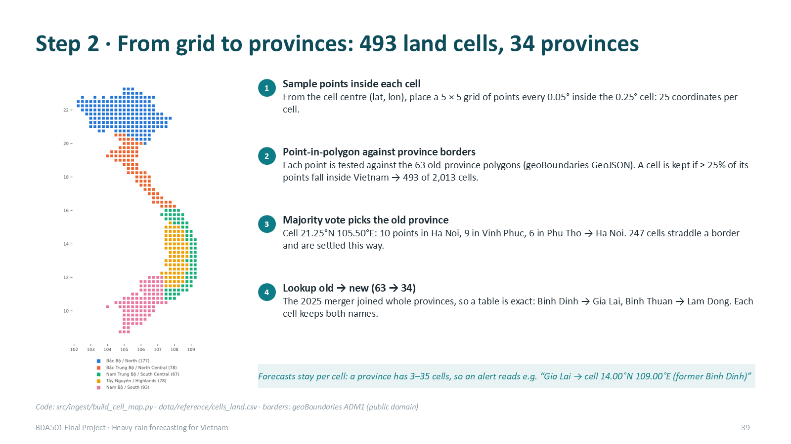

*Figure 1. Assigning ERA5 cells to provinces (deck slide).*

## 3. Architecture

Figure 2 shows the implemented system. Every component is tagged [I] implemented, [I*] implemented on the pilot data, or [P] design only (dashed). Figures 3 and 4 detail the batch and streaming lanes.

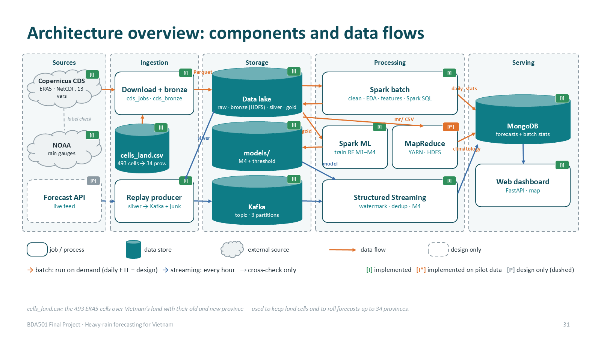

*Figure 2. Architecture overview with implementation status.*

| Component | Status | Technology |
|---|---|---|
| Download + bronze | [I] | Python (cdsapi, xarray) — Spark cannot read NetCDF |
| Data lake raw / bronze | [I] local disk + HDFS (lab cluster) | NetCDF zip, Parquet |
| Data lake silver / gold / models | [I] local Spark volume; on HDFS = [P] | Parquet partitioned by year |
| Cleaning, EDA, features, training | [I] | PySpark DataFrames, Spark SQL, Spark ML |
| MapReduce climatology | [I*] pilot data | Hadoop Streaming on YARN (lab cluster) |
| Streaming | [I] | Kafka 3.9 (KRaft, 1 broker), Spark Structured Streaming |
| Serving | [I] | MongoDB 7, FastAPI + Leaflet web map |
| Live data source, cluster deployment | [P] | NWP analysis/forecast API; YARN/Kubernetes, 3 Kafka brokers, Mongo replica set |

*Table 4. Components and implementation status.*

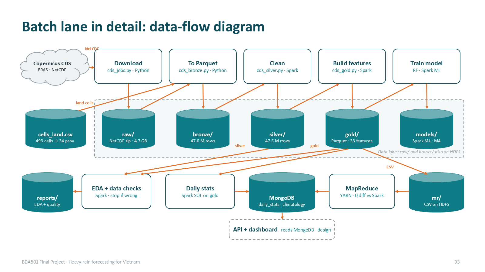

*Figure 3. Batch lane: who reads which layer and writes where.*

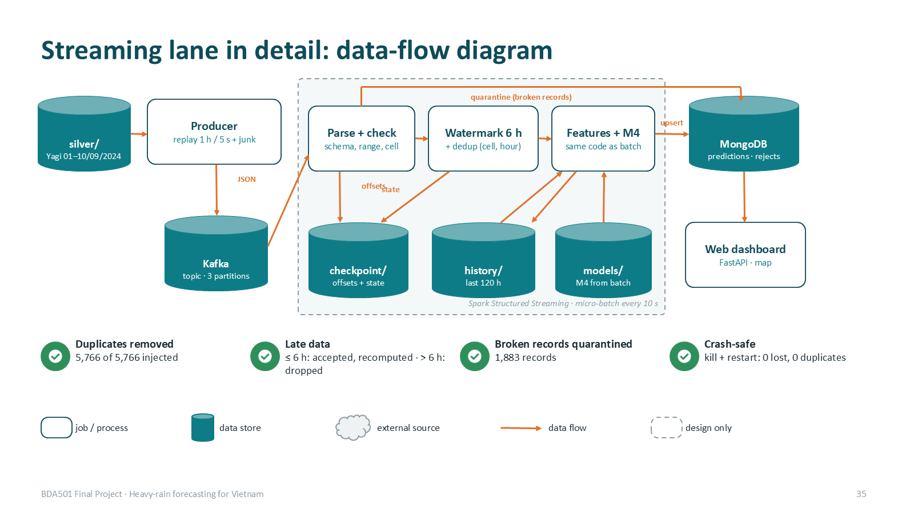

*Figure 4. Streaming lane: Kafka → checks → watermark/dedup → features + M4 → MongoDB → web.*

## 4. Data pipeline (medallion lake)

| Layer | Content | Rows / size | Tool |
|---|---|---|---|
| raw | CDS NetCDF zip as downloaded | 68 files, 4.7 GB | Python; copied to HDFS /rain-forecast/raw |
| bronze | one row per land cell × hour, CDS units and UTC unchanged | 47,552,808 rows, 1.8 GB | Python → Parquet; on HDFS |
| silver | mm, °C, %, hPa, km/h; Vietnam time; physical ranges → null | 47,540,976 rows, 2.9 GB | Spark |
| gold | label, split, 33 features (+ neighbour/terrain for the ablation) | 47,540,976 rows, 5.2 GB | Spark window functions |

*Table 5. Lake layers (official run).*

- Silver: rain m → mm, K → °C, Pa → hPa, cloud 0–1 → %; relative humidity from T and dew point (Magnus); wind speed and meteorological direction from u, v; UTC → Vietnam time; out-of-range values set to null, the row is kept.
- Gold: features at hour t use only hours ≤ t (windows of 3, 6, 24 and 72 h, 3 h and 24 h changes, month and hour as sin/cos); the label uses hours t+1 … t+24; a missing hour makes the window value null instead of a false 0 mm.
- Split by year: train 2015–2022 (34.6 M rows, 0.91 % heavy), validation 2023 (4.3 M, 0.67 %), test 2024–2025 (8.6 M, 1.21 %); 35,496 rows whose label window crosses a boundary are purged.
- Layout: Parquet partitioned by year so training never opens test folders; columnar storage lets each job read only the columns it needs; features stored as float32 to halve gold.

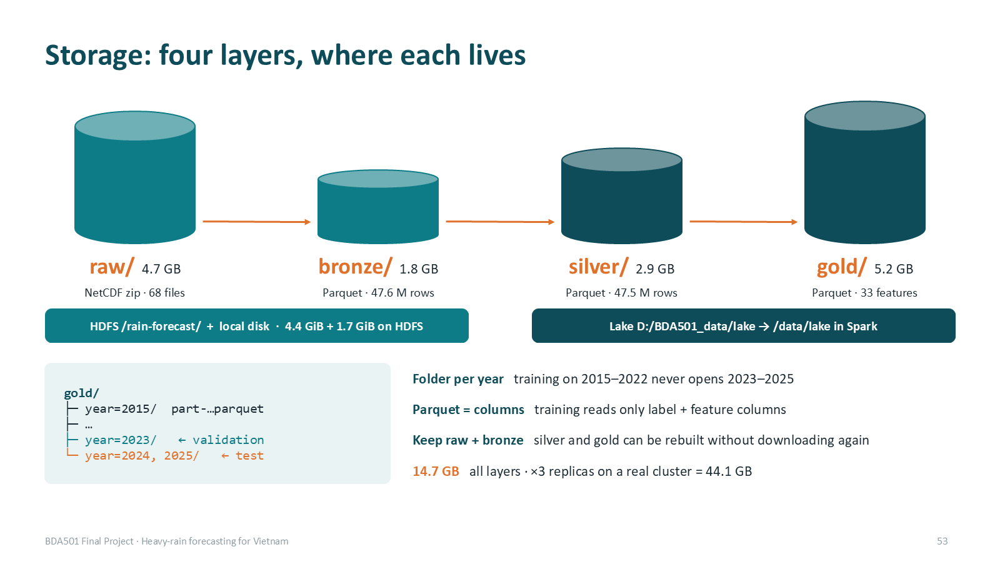

*Figure 5. Storage layers and layout.*

## 5. Exploratory analysis

- Heavy rain is rare (1 % of cell-hours) and seasonal: the season moves south with time — northern Vietnam peaks in August, the north-central coast in September–October, the south-central coast in October–November (5.7 % of cell-hours in November there).
- It is concentrated on the central coast: Huế 2.9 % of hours (3 × the national rate), then Đà Nẵng, Hà Tĩnh, Quảng Trị.
- It changes a lot between years: 0.59 % (2015) to 1.31 % (2025). Validation year 2023 was the second driest (0.66 %), the test years 2024–2025 among the wettest — the threshold is tuned on a dry year and applied to wet ones.

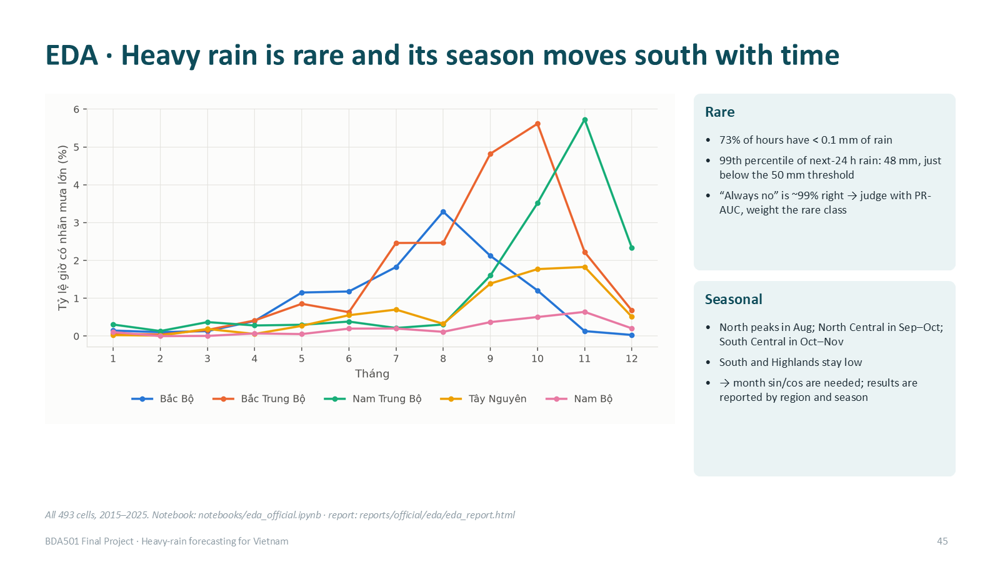

*Figure 6. Seasonality by region.*

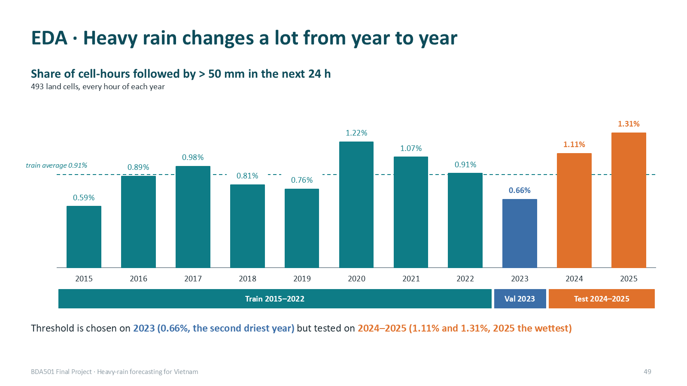

*Figure 7. Heavy-rain share by year and split.*

## 6. MapReduce and Spark SQL

Hadoop Streaming job (Python mapper/combiner/reducer on YARN) computing the climatology table: for each location × month, hours, heavy hours, heavy-rain rate, mean and maximum hourly rain over the training years. Map emits key location|month with (1, label, rain, rain); the combiner sums and takes the max inside each map task — safe because sum and max are associative and the rate/mean are computed only in the reducer; shuffle groups each key on one of 2 reducers. On the pilot data: 420,480 input rows, 4 map and 2 reduce tasks, the combiner cut shuffled records from 420,480 to 576 (730 ×), 144 output keys, and an independent Spark SQL computation agrees on 144/144 keys with 0 differences. The output feeds MongoDB (collection climatology) for look-up; it is not an input to the model (the evaluation baseline is recomputed in Spark). The same mapper/combiner/reducer were also run locally in Python on the full official train set: 34,561,272 rows → 47,328 combined records → 5,916 keys, 0 differences.

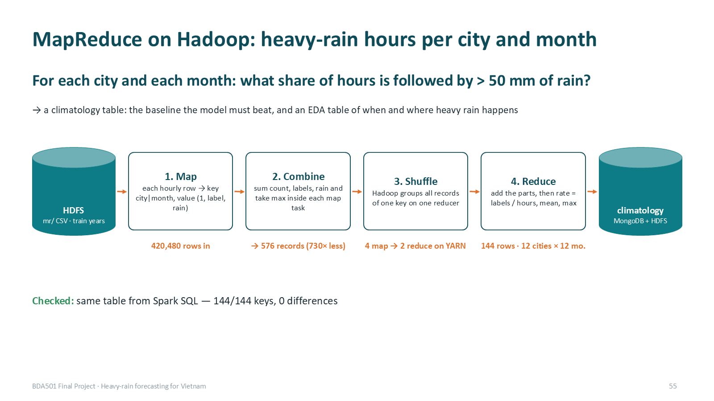

*Figure 8. MapReduce flow (pilot run).*

Spark SQL: three analytical queries (pilot data) — heavy-rain rate by region × month (GROUP BY, one shuffle), heavy-rain days by province × year joined with location and terrain tables (broadcast joins), top-5 wettest 24 h periods per location (window function, shuffle by location then sort). On the official gold we ran the province × year query and inspected its formatted plan (Section 9): two Exchanges (by cell-day, then by province-year) and a BroadcastHashJoin with the 493-row cell table; Parquet column pruning reads 3 of 51 columns.

## 7. Machine learning

### 7.1 Protocol

- Training sample: all heavy-rain rows plus 3 % of the others (1.31 M rows), positive weight × 3.26 (N0/N1 in the sample), so the model sees enough positives without running out of memory.
- Same hyper-parameters for every feature set: Random Forest, 100 trees, depth 12, min 20 rows per leaf, seed 42.
- Algorithm (by PR-AUC) and alert threshold (best F1) chosen on validation 2023 and frozen. The feature-set rule 'keep a group only if the bootstrap CI of its gain is above zero' was applied on the test years; re-checked on validation alone it gives the same choice (M4 0.210 vs 0.171-0.176 for M1-M3).
- Metric: PR-AUC (average precision), because accuracy of "always no" is 98.8 % and ROC-AUC is inflated by the huge number of dry hours (0.955 for our model). Uncertainty: block bootstrap by day (500 paired resamples).

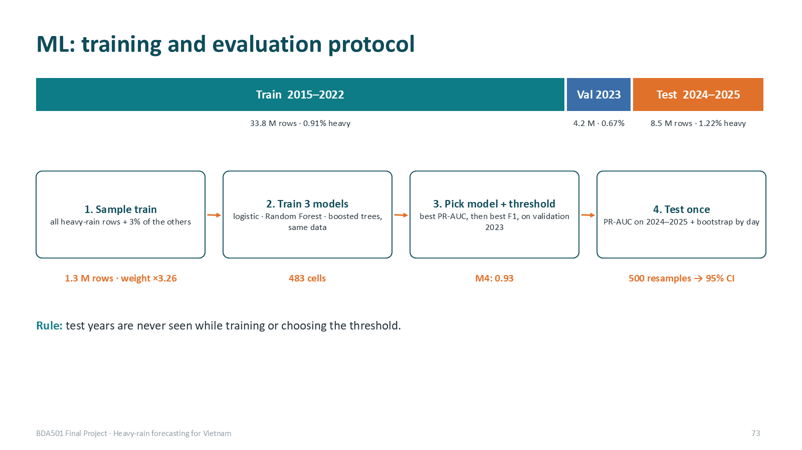

*Figure 9. Training and evaluation protocol.*

### 7.2 Feature selection (ablation)

| Set | Features | PR-AUC test | Δ vs M1 (95 % CI) |
|---|---|---|---|
| Persistence | rain in the last 24 h | 0.147 | — |
| M1 | 24 local weather | 0.361 | — |
| M2 | M1 + terrain (elevation, distance to coast, slope) | 0.363 | +0.002 (−0.003, +0.006) |
| M3 | M2 + 4 neighbour-cell features | 0.363 | +0.002 (−0.005, +0.008) |
| M4 | M1 + 9 atmosphere features | 0.420 | +0.059 (+0.029, +0.086) |

*Table 6. Ablation on 483 cells (10 edge cells lack two land neighbours), test 2024–2025, 8.46 M cell-hours.*

Only the atmosphere group passes the rule "CI above zero"; terrain also made things worse at unseen locations in the pilot leave-one-location-out test. The most important M4 features are 6-hour moisture convergence (15 %), rain in the last 3 h (15 %) and 6-hour cloud cover (11 %); windowed features carry 65–71 % of the importance. M4 gains most in the central regions (north-central coast 0.49 → 0.58, south-central 0.38 → 0.46, highlands 0.17 → 0.26) and stays weak in the south (0.03), where heavy rain is rare and convective.

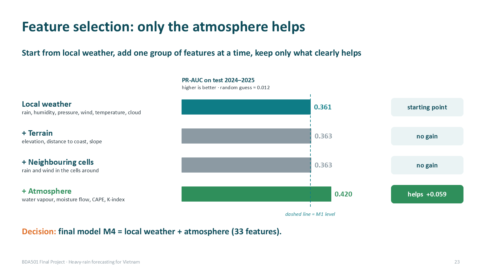

*Figure 10. Feature selection on official data.*

### 7.3 Algorithm comparison

| Algorithm (M4 features, same sample) | PR-AUC validation | PR-AUC test | Train time |
|---|---|---|---|
| Logistic regression (standardised, L2 1e-4) | 0.180 | 0.368 | 59 s |
| Random Forest (100 trees, depth 12) | 0.210 | 0.420 | — |
| Gradient-boosted trees (100 rounds, depth 6) | 0.200 | 0.412 | 264 s |

*Table 7. Algorithms compared; Random Forest kept on validation PR-AUC.*

Random Forest beats logistic regression by +0.052 (CI +0.022 … +0.077); gradient-boosted trees are −0.006 (CI −0.027 … +0.013), a statistical tie. Random Forest is kept: best on validation, trains its trees in parallel and gives feature importance.

### 7.4 Final results and warning threshold

| Threshold (chosen on 2023) | TP | FP | FN | Precision | Recall |
|---|---|---|---|---|---|
| 0.932 — best F1 (reported) | 47,714 | 60,688 | 55,164 | 44.0 % | 46.4 % |
| 0.739 — recall ≥ 60 % on 2023 | 75,687 | 331,316 | 27,191 | 18.6 % | 73.6 % |

*Table 8. Warning trade-off on test 2024–2025 (102,878 heavy cell-hours).*

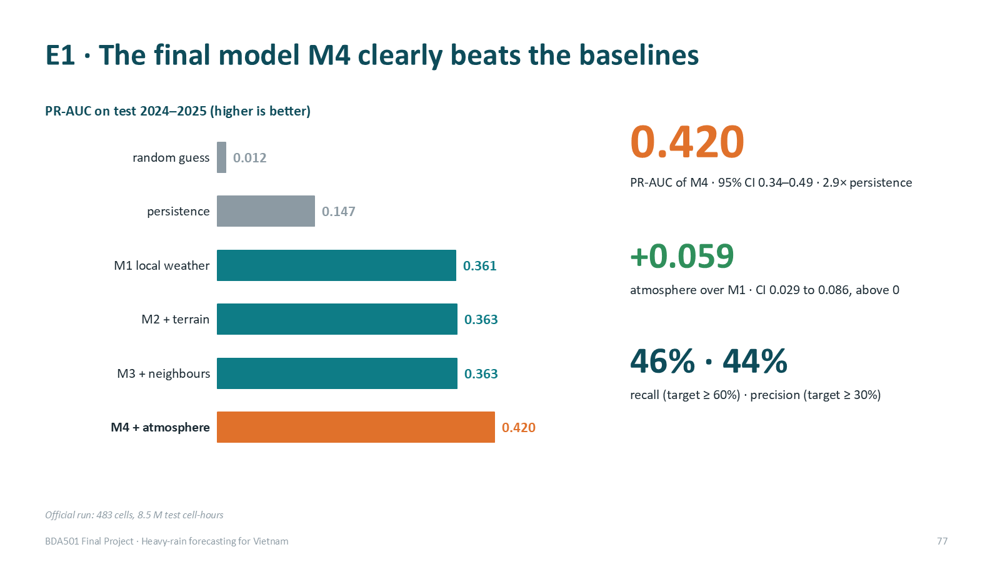

*Figure 11. Final model versus baselines on the test years.*

No threshold reaches recall ≥ 60 % and precision ≥ 30 % at the same time. The F1 threshold misses about half of the heavy-rain cell-hours, so the safe claim is decision support for forecasters; the recall-first threshold halves the misses at the cost of about 5.5 × more false alarms: each extra heavy-rain cell-hour caught costs 9.7 extra false alarms, so recall-first is justified only if one miss costs more than about ten false alarms. We propose two levels: watch at p ≥ 0.739, warning at p ≥ 0.932. The 0.932 threshold is a score cut-off, not a 93 % probability: the rebalanced training sample inflates scores and Random Forest probabilities are not calibrated.

## 8. Streaming and NoSQL serving

### 8.1 Design

- Source: a producer replays silver for 1–10 September 2024 (Typhoon Yagi), 493 messages per hour of data, one hour every 5 s, into the Kafka topic weather.silver.hourly (3 partitions, key = cell). The first 72 h are sent at once to warm up the 72 h features; the demo then waits for a Start button on the web page.
- Spark Structured Streaming, two queries on the topic: rejects (malformed JSON, missing field, impossible value, unknown cell → quarantine collection in MongoDB) and forecast: withWatermark(event_time, 6 h) + dropDuplicatesWithinWatermark(cell, event_time), then foreachBatch keeps a 120 h history buffer, computes the 33 features with the same functions as batch, scores M4 with the 2023 threshold and upserts MongoDB.
- Fault tolerance: checkpoint (Kafka offsets, dedup state, commit log); every write is idempotent — MongoDB upsert by _id = cell|hour, history buffer written to a new folder per batch, counters stored per batch id.
- Serving: one MongoDB document per cell-hour (probability, alert, province, revisions, observed rain once t+24 h has passed); province_risk per province-hour; the FastAPI page reads them every 2 s (map, per-cell chart, top provinces, quarantined records, live batch counters).

### 8.2 Robustness test with injected junk and a crash

scripts/stream_scenarios.sh injects junk that carries no flag (Spark must detect it) and kills Spark with SIGKILL at replay hour 110 for 45 s while the producer keeps sending.

| Case | Injected | Handled by Spark | How |
|---|---|---|---|
| Duplicates (immediate + 1–3 h later) | 5,766 | 5,766 dropped | watermark + dedup |
| Late ≤ 6 h and out of order | 6,984 | 6,914 accepted (estimate) | affected hours recomputed |
| Late > 6 h | 89 | 20 dropped | watermark (lags during bursts) |
| Broken records (4 types) | 1,883 | 1,883 quarantined | rejects query |
| Missing hours (5 cells × 6 h) | 30 | no forecast for affected windows | never treated as 0 mm |

*Table 9. Dirty-data handling (clean run, 125,939 messages).*

- No loss, no double read: 125,939 messages in the topic = 125,939 read by each query, across the crash.
- 0 duplicate forecasts in MongoDB; 0 duplicate rows reaching foreachBatch.
- Parity: recomputing in batch on exactly the rows the stream accepted gives identical probabilities for 81,710 / 81,710 cell-hours and 0 alert differences; for 4 sample cells, 658 cell-hours × 33 features = 21,714 feature values identical (Card E check E3).
- Watermark semantics: Spark's watermark is the maximum event time of previous micro-batches minus 6 h, so during bursts some messages more than 6 h late are still accepted; Spark guarantees to keep data < 6 h late, not to drop everything older. Correctness relies on recomputation + upsert.

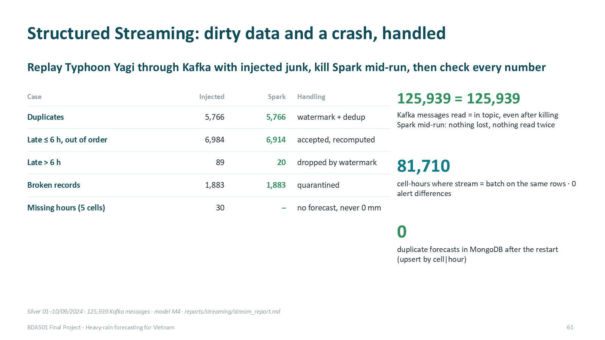

*Figure 12. Streaming robustness results.*

### 8.3 What the stream predicted for Typhoon Yagi

For the Hải Phòng and Quảng Ninh cells the probability crossed the threshold on the evening of 5 September, about a day before landfall, and stayed above it through the 6–7 September peak (up to 196 mm in 24 h). In these two cells 59 of 79 alerts were followed by heavy rain and 59 of 123 heavy-rain hours were caught; over all cells from 4 to 9 September recall was 70 % and precision 74 %. Much of the rain after landfall (8–9 September) was missed: local features see a weakening system — the motivation for upwind features.

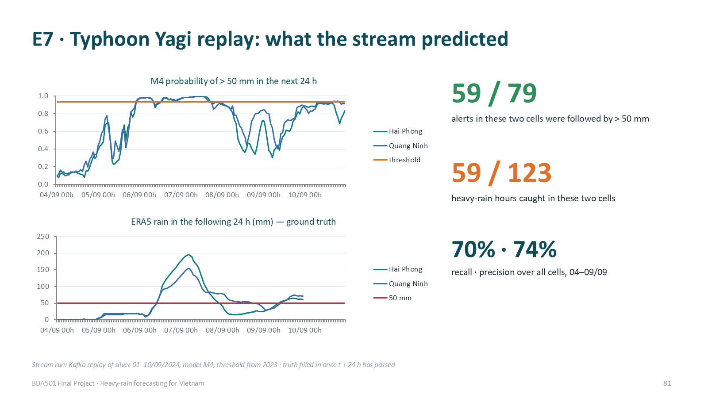

*Figure 13. Stream forecasts and observed rain during Typhoon Yagi.*

## 9. Performance experiment

Controlled experiment on the official data (Spark 4.2 local[3], driver 4 GB, AQE off, noop sink, 1 warm-up + 2–3 timed runs, shuffle metrics from the Spark REST API).

| Experiment | Setting | Mean time | Tasks | Shuffle write |
|---|---|---|---|---|
| M4 feature build, 5.79 M rows | 4 partitions | 29.2 s | 36 | 508 MB |
|  | 16 | 39.9 s | 48 | 508 MB |
|  | 64 | 38.0 s | 96 | 508 MB |
|  | 200 (default) | 36.9 s | 232 | 508 MB |
| Province × year query, 47.5 M rows | SortMergeJoin | 30.4 s | 127 | 45.5 MB |
|  | BroadcastHashJoin | 32.9 s | 111 | 23.2 MB |

*Table 10. Measured performance.*

With 3 cores, 4 partitions are fastest: the shuffle volume is the same for every setting, more partitions only add task overhead. Broadcasting halves the shuffle but is not faster here, because the join happens after aggregation to ~2 M cell-days and reading 47.5 M rows dominates — our hypothesis was not confirmed for this query. On a cluster the best partition count grows with executor cores and data size (≈ 2–3 × cores, ~100–200 MB per partition); one laptop cannot prove production-scale performance.

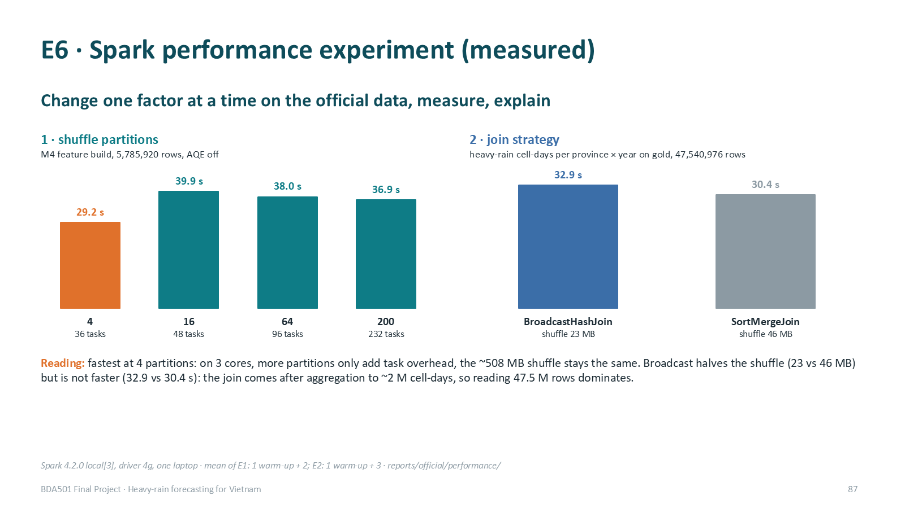

*Figure 14. Performance experiment.*

## 10. Validation

| Check | Result |
|---|---|
| Row counts | bronze 47,552,808 → silver 47,540,976 (−493 × 24 h outside 2015–2025 after UTC → Vietnam time) → gold 47,540,976 |
| Duplicates | 0 duplicate (cell, hour) keys in silver and gold (job stops otherwise) |
| Completeness / nulls | 5,423 cell-years, 0 incomplete; nulls only cape (2) and k_index (243) |
| Independent processing check | same ERA5 via Open-Meteo at 63 points: daily rain correlation 0.9998; hourly correlation highest at lag 0 (0.989 vs 0.70 at ±1 h) ⇒ time zone correct |
| Label vs real gauges | 14 NOAA gauges: totals ratio 1.04; ERA5 reaches 50 mm on 25 % of gauge heavy days ⇒ the label is cell-average heavy rain |
| Leakage | unit tests change future data and check past features are unchanged; exact label window; split purge; expver = ERA5 final (0001) for every hour 2015–2025, so no later revision mixes into training |
| Labels from raw | recomputed with numpy from the NetCDF files: identical to Spark (train 313,169 / val 28,683 / test 104,439 positives) |
| MapReduce vs Spark SQL | 144 / 144 keys, 0 differences (pilot, YARN); full official train set 34.6 M rows: 5,916 keys, 0 differences (local Python run of the same mapper/combiner/reducer) |
| Stream vs batch | 81,710 cell-hours and 21,714 feature values identical |

*Table 11. Validation evidence (details in evidence/session9/).*

## 11. Deployment design and reproducibility

Design (not run on a cluster): Spark on YARN or Kubernetes (managed: Dataproc/EMR), driver in cluster mode; batch with dynamic allocation on spot workers (restartable from lineage), streaming on 2 fixed executors on on-demand nodes; lake and checkpoints on HDFS or object storage; Kafka with 3 brokers and replication factor 3; MongoDB replica set with w: majority; Spark UI/History Server and our per-batch counters for observability; credentials only in local config files, Kerberos/IAM and TLS on the cluster.

Reproducibility: the README runs the whole official pipeline from the raw CDS download to the model, the streaming demo and the deck; versions are pinned (Spark 4.2.0, Java 17, Python 3.11, Kafka 3.9.1, MongoDB 7) in Dockerfiles and requirements.txt; seed 42 everywhere; no credentials in the repository (scanned before every push). Code: https://github.com/PhamLeTanThinh/BDA501_weather.

## 12. Limitations and future work

| Limitation | Impact | Next step |
|---|---|---|
| ERA5 is published ~5 days late | 29 of 33 features unavailable at issue time; the demo is a hindcast | retrain and re-validate on NWP analysis + station data |
| Recall 46 % at the F1 threshold | misses half of heavy-rain cell-hours | recall-first threshold, probability calibration, upwind features |
| Rain after landfall missed | Yagi 8–9 September | features from 100–300 km / upwind |
| Label = ERA5 cell, not gauge | 25 % agreement on gauge heavy days | verify with more gauges or radar |
| Year-to-year shift | threshold tuned on a dry year | periodic re-tuning and drift monitoring |
| Single-node infrastructure | no proof of cluster scaling | YARN, 3 Kafka brokers, Mongo replica set; repeat the performance experiment |
| MapReduce / Spark SQL on pilot data | not yet on the official data | rerun on official gold |
| Hyper-parameters not tuned | RF and GBT may improve | small grid search on validation |

*Table 12. Limitations.*

## 13. Conclusion

The system runs end to end on 47.5 million cell-hours: Copernicus CDS → HDFS-backed lake → Spark (SQL, ML) and Hadoop MapReduce → Kafka and Structured Streaming → MongoDB → web map. Measured evidence supports three claims: atmospheric moisture features materially improve heavy-rain skill (PR-AUC 0.420 vs 0.361 local-only and 0.147 persistence); the choice of Random Forest is justified against two alternatives; and the streaming lane is robust to dirty data and crashes while staying identical to batch. The forecast is not yet a stand-alone warning service — it needs operational inputs and higher recall — but it is a sound, reproducible base for one.

## References

- Hersbach H. et al. (2020). The ERA5 global reanalysis. Quarterly Journal of the Royal Meteorological Society, 146, 1999–2049.
- Copernicus Climate Change Service (C3S). ERA5 hourly data on single levels from 1940 to present. Climate Data Store.
- Prime Minister of Vietnam (2021). Decision 18/2021/QĐ-TTg on forecasting, warning and transmission of natural disaster information and disaster risk levels.
- Runfola D. et al. (2020). geoBoundaries: a global database of political administrative boundaries. PLOS ONE 15(4).
- Menne M. J. et al. (2012). An overview of the Global Historical Climatology Network-Daily database. J. Atmos. Oceanic Technol. 29, 897–910.
- Breiman L. (2001). Random Forests. Machine Learning 45, 5–32.
- Saito T., Rehmsmeier M. (2015). The precision-recall plot is more informative than the ROC plot when evaluating binary classifiers on imbalanced datasets. PLOS ONE 10(3).
- Apache Spark 4.2 documentation: Structured Streaming programming guide (watermarking, dropDuplicatesWithinWatermark), MLlib.
- Leskovec J., Rajaraman A., Ullman J. D. (2020). Mining of Massive Datasets, 3rd ed. (MapReduce, streams).
- Bahga A., Madisetti V. (2019). Big Data Analytics: A Hands-On Approach.

## Appendix A. Evidence and run commands

| Item | Location |
|---|---|
| Session 9 evidence pack (A–I) | evidence/session9/ |
| Quality and EDA reports | reports/official/quality/, reports/official/eda/, notebooks/eda_official.ipynb |
| Model results and manifests | reports/official/model/ |
| Performance experiment and query plans | reports/official/performance/ |
| Streaming measurements and parity | reports/streaming/stream_report.md |
| Presentation deck | deck/BDA501_Heavy_Rain_Forecast.pptx |
| Full pipeline commands | README.md (official CDS pipeline, streaming demo, MapReduce) |

*Table 13. Where to find the evidence.*
